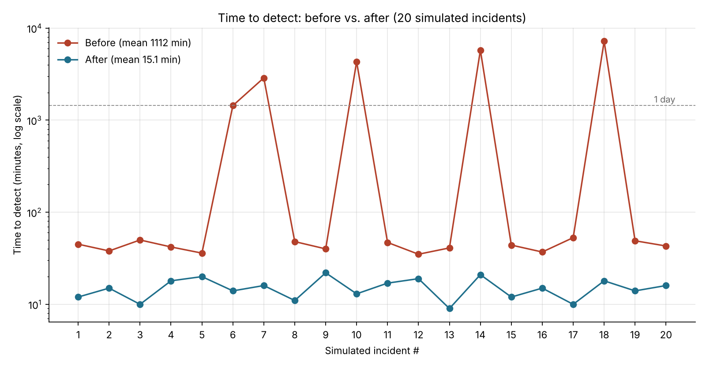

# NIST CSF Gap Analysis, Vulnerability Remediation & Risk Assessment

A hands-on security assessment and hardening project for a **simulated** industrial equipment supplier, with a full technical writeup. It covers gap analysis, risk assessment, vulnerability remediation, encryption, MFA, detection (IDS/SIEM/DLP), physical access control, incident response and security awareness, organized around the NIST Cybersecurity Framework.

> The client ("Techcorp") and consultant ("Cyberworks") are fictional. All results come from a simulated environment.

## Results

| Metric | Before | After |
|---|---|---|
| Mean time to detect (20 simulated incidents) | 1,112 min (18.5 h) | 15.1 min |
| Incidents taking 1 day or more to detect | 5 of 20 (longest 5 days) | 0 of 20 (longest 22 min) |
| Patch coverage (audit-log verified) | Outdated systems | 100% |
| Unaddressed critical vulnerabilities after re-scan | n/a | 0 |
| Databases encrypted (TDE, AES-256) | 0 of 3 | 3 of 3 |
| Employee training completion | None | 100% |



The median pre-implementation detection time was 46 minutes. The average was pulled up by five long outliers, which is the point: a few slow detections were the real exposure.

## What I did
- **Identify:** security audit, gap analysis, NIST SP 800-30 risk assessment and risk matrix, baseline metrics.
- **Protect:** scan-driven patching with re-scan validation; BitLocker and SQL TDE (AES-256); MFA with Entra ID and Microsoft Authenticator; badge system with role-based access and time-of-day restrictions; security awareness training.
- **Detect:** IDS, SIEM with dashboards and alerts, DLP, CCTV.
- **Respond:** incident response runbooks and an escalation chain.
- **Recover / verify:** simulated phishing, penetration test before handoff, lessons-learned review.
- **Unplanned finding:** a SQL injection flaw in the client website, fixed with parameterized queries and input validation without moving the handoff date. See [lessons learned](lessons-learned/sql-injection-scope-creep.md).

## NIST CSF mapping

| Function | Controls and activities |
|---|---|
| Identify | Audit, gap analysis, risk assessment, baseline MTTD |
| Protect | Patching, encryption, MFA, RBAC, training |
| Detect | IDS, SIEM, DLP, CCTV, MTTD testing |
| Respond | Runbooks, escalation chain |
| Recover | Lessons learned, phishing simulations, pentest verification |

## Repository guide

| Path | Contents |
|---|---|
| [`docs/case-study.md`](docs/case-study.md) | Full writeup: problem, approach, decisions, timeline, results, limitations, references |
| [`detection/`](detection/) | Raw 20-incident data (CSV), analysis script, chart |
| [`encryption/`](encryption/) | T-SQL queries and output verifying TDE on three databases |
| [`physical-security/`](physical-security/) | Role-based physical access matrix |
| [`lessons-learned/`](lessons-learned/) | SQL injection scope-creep write-up |

## Reproduce the detection analysis
```bash
pip install matplotlib
python detection/analyze_mttd.py
```

## Tools and technologies
Microsoft Entra ID · Microsoft Authenticator · BitLocker · SQL Server TDE · T-SQL · PowerShell · vulnerability scanning · IDS · SIEM · DLP · CCTV and badge access

## Frameworks and sources
NIST CSF · NIST SP 800-30 · CISA Zero Trust Maturity Model · SANS Security Awareness Report · Verizon DBIR · IBM Cost of a Data Breach · Gartner SIEM research

## Limitations
Simulated environment; the 20 incidents are simulated, not live attacks. MTTD is a mean over a small sample, so treat it as directional.

## Author
Noah Tongen · aspiring cybersecurity analyst · Security+, CySA+, Network+, A+
